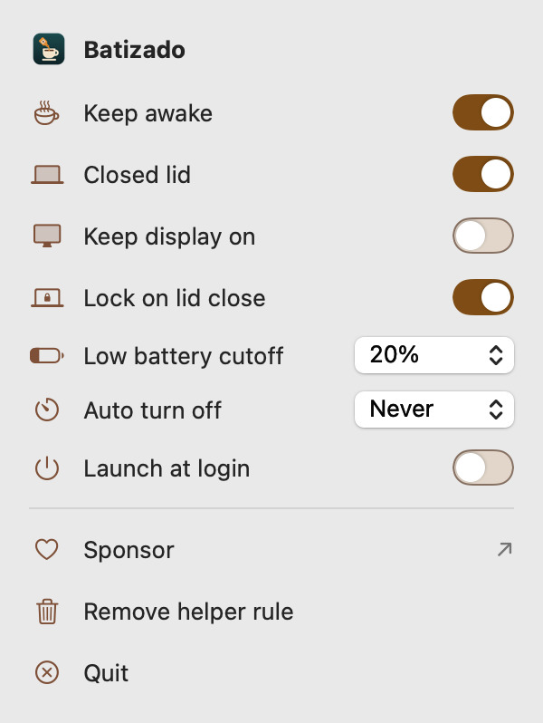

<p align="center">
  
</p>

<h1 align="center">Batizado</h1>

<p align="center">
  Keeps your MacBook awake with the lid closed,<br>
  and backs out by itself on low battery, heat or a crash.
</p>

<p align="center">
  
  
  
  <a href="LICENSE"></a>
</p>

<p align="center">
  <picture>
    <source media="(prefers-color-scheme: dark)" srcset="assets/readme/popover-dark.png">
    
  </picture>
</p>

Batizado is a macOS menu bar app that keeps your MacBook awake with the lid closed, so long-running coding
agents keep working while you check on them remotely. Coffee keeps you awake; a shot of rum in it keeps the
Mac awake even with the lid shut.

> **Status: 0.1.0, the first release.** It runs on one kind of machine the maintainer owns (an Apple Silicon
> MacBook on macOS 27). The decision logic is unit tested; everything that touches the system (the lid, the
> password prompt, the screen lock, notifications, the protections reverting for real) is checked by hand
> before a release, mostly through debug-only test modes. A real thermal emergency has never been observed.

## The name

*Café batizado* is Brazilian for coffee "baptized" with a shot of something stronger, usually cachaça or
rum. Plain coffee is what Keep awake does. Closed lid is the stronger stuff, so its menu bar icon is the cup
with the bottle pouring in.

## Why

Apps that promise a "closed lid" mode usually hold a `PreventSystemSleep` power assertion. macOS ignores that
assertion when the lid closes without an external display, so the Mac sleeps anyway. The setting that always
works is `pmset disablesleep 1`, which needs administrator rights and is dangerous on its own: the Mac stays
awake until the battery dies or it overheats in a bag, and the setting survives a reboot.

Batizado uses `disablesleep` and wraps it in safeguards.

## What the menu does

Click the cup in the menu bar. The rows, top to bottom:

- **Keep awake**: holds a power assertion so the Mac does not idle-sleep while the lid is open. Needs no
  privileges and installs nothing.
- **Closed lid**: runs `pmset -a disablesleep 1`, so the Mac stays awake with the lid closed, on AC or on
  battery. Turning it on also turns Keep awake on. The switch shows the real `SleepDisabled` value read from
  the system, not what the app asked for; if the two disagree, the menu bar icon shows a warning. The first
  time, it asks for your administrator password once to install the helper rule (see below).
- **Keep display on**: keeps the display from sleeping too, while Keep awake is on.
- **Lock on lid close** (on by default): with Closed lid on, closing the lid locks the screen, unless an
  external display is in use. Unplugging the last external display with the lid closed also locks.
- **Low battery cutoff** (20% by default, 5% to 50%): with Closed lid on, on battery, at or below this level,
  Closed lid and Keep awake are turned off. Never while charging.
- **Auto turn off** (Never, 1, 2, 4 or 8 hours): turns Keep awake and Closed lid off after that long. A
  notification five minutes before offers "Extend 30 min"; the menu shows the countdown and the same button.
  The deadline survives quitting and restarting.
- **Launch at login**: opens Batizado when you log in.
- **Sponsor**: opens the GitHub Sponsors page.
- **Remove helper rule**: turns Closed lid off and, once `SleepDisabled` reads 0 again, removes the helper
  rule (asks for the password). If Closed lid cannot be turned off, the rule is kept, no password is asked
  and the menu says why: without the rule nothing could turn it off later.
- **Quit**: turns off what the app turned on and quits.

The menu bar icon has four states:

| Icon | State |
| :---: | --- |
| <picture><source media="(prefers-color-scheme: dark)" srcset="assets/readme/menubar-off-dark.svg"></picture> | Everything is off. |
| <picture><source media="(prefers-color-scheme: dark)" srcset="assets/readme/menubar-awake-dark.svg"></picture> | Keep awake is on. |
| <picture><source media="(prefers-color-scheme: dark)" srcset="assets/readme/menubar-closed-lid-dark.svg"></picture> | Closed lid is on: the Mac stays awake with the lid shut. |
| <picture><source media="(prefers-color-scheme: dark)" srcset="assets/readme/menubar-diverged-dark.svg"></picture> | The real `SleepDisabled` value differs from what you asked for. |

When you open Batizado again after Quit, a crash or a restart, Keep awake and Closed lid come back as you
left them. They do not come back after a protection, the timer or turning them off yourself.

## Protections

A separate guardian process watches the app and the Mac while Closed lid is on. Closed lid only turns on
after the guardian confirms, within 12 seconds, that it is running and watching this copy of the app;
otherwise it stays off and the menu explains how to bring the guardian back. If the guardian quits while
Closed lid is on, launchd starts it again, and if no guardian confirms within 12 seconds the app turns Closed
lid off. The guardian turns `disablesleep` back off when:

- the battery reaches the Low battery cutoff while on battery;
- macOS reports a serious or critical thermal state;
- the app crashes or is killed (`kill -9`);
- the Mac restarted with Closed lid on (the setting survives a reboot; the guardian turns it off when you log
  in).

After a battery, thermal or timer shutdown, Closed lid and Keep awake stay off until you turn them on again,
the app sends a notification and the menu says why. Closed lid refuses to turn on while the battery is at
the cutoff or the Mac is too hot. After a crash or a restart, the menu says what happened and the app turns
Closed lid back on the next time it opens.

Once the guardian decides to turn it off, the decision is written to disk and carried through: if the
command fails, it tries again (after 2 s, then 4 s, and so on, at most once a minute) until it succeeds,
even if the Mac cools down or gets plugged in meanwhile, and a restarted guardian picks it up.

The guardian only reverts what the app armed: a `disablesleep 1` you set yourself in a terminal is left alone.
The one exception is the 5 seconds after it cleans up after a crashed app: a `disablesleep 1` that appears then
is taken for the app's last command, still on its way, and turned off.

## What gets installed, and why a password is asked once

Nothing in this project runs as root. Everything below is created by the app as your user, except the helper
rule.

| What | Where | When |
| --- | --- | --- |
| The app (with the guardian inside it) | `/Applications/Batizado.app` | `make install` |
| Helper rule | `/etc/sudoers.d/batizado` | first time you turn Closed lid on (password) |
| Guardian LaunchAgent | `~/Library/LaunchAgents/io.github.victorhugobn.batizado.guardian.plist` | every time the app opens |
| Login LaunchAgent | `~/Library/LaunchAgents/io.github.victorhugobn.batizado.login.plist` | when Launch at login is on |
| Shared state | `~/Library/Application Support/Batizado/`: `armed.json`, `acknowledged.json`, `pending-revert.json`, `last-shutdown.json` | while Closed lid is on, and after a shutdown |
| Preferences | the `io.github.victorhugobn.batizado` defaults domain | when you change a toggle |

**The helper rule.** Changing `disablesleep` needs root. Instead of a root daemon, the app asks once, through
the standard macOS password window, to install this file (owned by root, mode 0440, validated with
`visudo -c` before it is moved into place), where `you` is your short user name:

```
# Installed by Batizado. Lets one user toggle pmset disablesleep, nothing else.
you ALL = (root) NOPASSWD: /usr/bin/pmset -a disablesleep 0, /usr/bin/pmset -a disablesleep 1
```

From then on the app runs `/usr/bin/sudo -n /usr/bin/pmset -a disablesleep 0` or `1`, and the guardian only
the `0`, always with fixed arguments and never asking for a password again. Check what the rule allows with `sudo -l`.

**The accepted risk.** Any process running as your user can run those two commands without a password. The
worst it can do is keep your Mac from sleeping, or let it sleep. Remove the rule with "Remove helper rule" when
you stop using Closed lid.

**The LaunchAgents** are plain plists, not `SMAppService` items (ad-hoc signed apps lose that registration on
every rebuild). The guardian agent starts the guardian at login and restarts it if it dies; it is loaded even
while Closed lid is off, so it can clean up after a restart without the app. The login agent runs
`/usr/bin/open` on the app once at login. macOS may show a "Background Items Added" notice for them.

## Install from source

There are no prebuilt binaries. Requirements:

- Apple Silicon Mac, macOS 14 or later
- Xcode 27 with its license accepted (`sudo xcodebuild -license accept`). The Makefile selects the Xcode
  toolchain itself; you do not need to change `xcode-select`.

```sh
git clone https://github.com/VictorHugoBN/batizado.git
cd batizado
make install      # builds, signs ad hoc and copies Batizado.app to /Applications
open /Applications/Batizado.app
```

`make install` over an existing copy quits it first (which turns Closed lid off) and restarts the guardian, so
the new guardian binary runs right away. Open the app again afterwards. `make install INSTALL_DIR=<folder>`
installs somewhere else.

## Uninstall

First click **Remove helper rule** in the menu (it needs your password). Then, from the repository:

```sh
make uninstall    # or: make uninstall INSTALL_DIR=<folder> if you installed elsewhere
```

It removes the login agent first, quits the app (which turns Closed lid off), waits for the guardian if it
still has something to revert, and checks that `SleepDisabled` reads 0. Only then does it unload and delete
the guardian agent, and delete `~/Library/Application Support/Batizado/`, the preferences and the app.

It never runs `sudo`. If the helper rule is still there, it prints the command to remove it:

```sh
sudo rm -f /etc/sudoers.d/batizado
```

If `SleepDisabled` is not a confirmed 0 (still 1, or unreadable), it stops before touching the guardian or
its state, prints the commands and exits with an error: run `sudo pmset -a disablesleep 0`, check that
`pmset -g | grep SleepDisabled` prints 0, then run the uninstall again.

macOS may keep Batizado's entry in System Settings > Notifications; remove it there if you want.

## Limitations

- **No protection outside your login session.** The guardian is a user LaunchAgent. After you log out, and
  between boot and login, nothing turns `disablesleep` off: if the Mac restarts with Closed lid on, it will
  not sleep until you log in.
- With Closed lid on, the "Sleep" item in the Apple menu is unavailable; that is what `disablesleep` does.
- Apple Silicon only. macOS 14 or later, but tested on macOS 27 only.
- Signed ad hoc, with no Developer ID: build it yourself from source. Gatekeeper may warn if you copy the app
  to another Mac.
- The screen lock uses `SACLockScreenImmediate` from the private `login.framework`. A future macOS may remove
  it; the app logs when it is unavailable. As a fallback, `defaults write io.github.victorhugobn.batizado
  lockMechanism displaySleep` sleeps the display instead, which only locks if "Require password" is set to
  "Immediately".
- The battery and thermal protections need the guardian; the timer runs in the app only.

## Contributing

`AGENTS.md` describes the project layout, rules and feedback loops for both humans and coding agents. Run
`make setup` once to install the pre-commit hooks, and `make check` (lint, build and tests) before every
commit. `make help` lists every target.

## Sponsor

If Batizado keeps your agents running, you can
[buy me a batizado coffee](https://github.com/sponsors/VictorHugoBN).

## License

[MIT](LICENSE)
